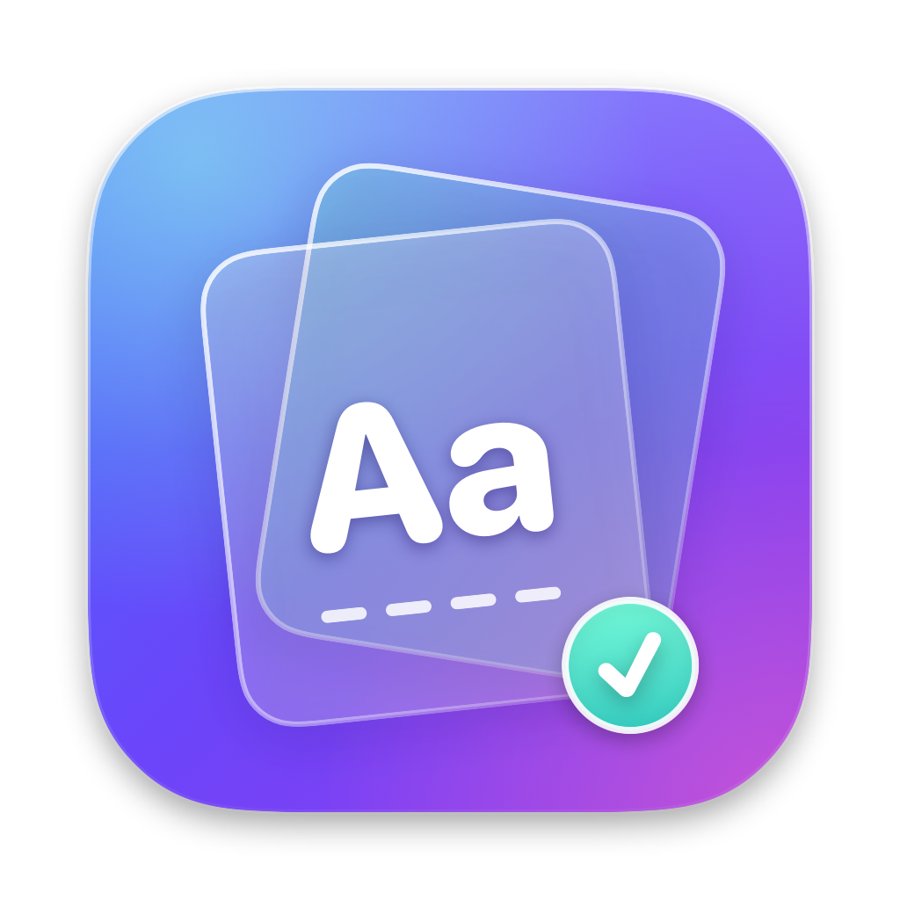

<p align="center"></p>

# Gloss

Gloss is a small macOS menu bar app that helps a Chinese-speaking engineer practise English
spelling from their own Obsidian notes. It reads your vocabulary tables and daily mistake logs,
quizzes you with spaced repetition, nudges you when cards are due, and fixes the English you
select anywhere with one shortcut.

It has no Dock icon. It never writes to your vault.


> Screenshot placeholder: run `make screenshot` and copy `shots/now.png` to `docs/screenshot.png`.

## Features

- **Overview menu** – click the icon for "English Health", tiles for due cards, 7-day accuracy, streak,
  Leitner boxes, this week's mistakes and Fix my English, plus today's recommendation. "Start Quiz" opens
  the quiz in the same menu.
- **One window** – the Gloss window has a sidebar with Overview, Quiz, Stats, Fix My English (type or paste
  text) and Settings (⌘1–5). The menu bar popover is the quick version; everything else opens in this window.
- **Finding Gloss** – it has no Dock icon. Click the book icon in the menu bar, press ⌃⌥G from anywhere
  (configurable), or open Gloss.app again: each shows the overview. The first launch shows it with a short
  "where to find me" note.
- **Menu bar badge** – the `character.book.closed` icon shows how many cards are due now.
- **Spelling quiz** – a card shows the Chinese meaning, the first letter and the letter count,
  for example `容量 → c_______ (8)`. Type the word and press Enter. Case and extra spaces are ignored.
  A right answer shows a green check and moves on. A wrong answer shows the right spelling with the
  wrong letters marked, your attempt, and your memory hint; the card comes back later in the round.
- **Spaced repetition** – Leitner boxes 1–5 with intervals of 10 minutes, 1 day, 3 days, 7 days and
  21 days. New cards come in order of how often you got them wrong. A card you answered correctly is
  not shown again the same day.
- **Extra practice** – after the day's reviews: Hardest 10, Random 10, Today's words, or Learn 10 new.
  Practice rounds never change your review schedule.
- **Nudges** – a notification every N minutes (default 60) while cards are due, except in quiet hours
  (default 22:00–09:00). Click it to open the quiz.
- **Fix my English** – select text in any app and press ⌃⌥E (configurable). Gloss copies the selection
  (and puts your clipboard back), asks `claude -p` for a correction, and shows the fixed text, a shorter
  version and each mistake with a Chinese explanation in a floating panel, with Copy buttons.
- **Letter boxes and motion** – each card shows one box per letter that fills as you type. Tiles fade in,
  numbers roll, a wrong answer shakes the card, a right one bursts into sparks. Turning on
  *Reduce motion* in System Settings turns the motion off.
- **Pronunciation** – a speaker button (⌘P) on every card says the word with the system English voice;
  the word is also spoken after each answer. A setting can speak it when the card appears (dictation).
  The fix panel has Listen buttons for the fixed and shorter sentences.
- **Glass look** – a dark blue-violet theme with rounded glass cards and buttons: Apple's Liquid Glass on
  macOS 26, a frosted material on macOS 14–15.
- **Stats** – mistakes per category in the last 7 and 30 days, your 10 most repeated spelling words,
  and quiz accuracy per day.
- **Settings** – vault folder, decks, new cards per day, reminder interval, quiet hours, shortcut,
  launch at login.

## Build

Needs macOS 14 or later and Xcode 15 or later (or the matching command line tools).

```sh
swift build          # debug build
swift test           # unit tests for GlossCore
make app             # or ./scripts/bundle.sh → build/Gloss.app (ad-hoc signed)
make run             # build and open the app
make install         # copy it to /Applications
```

Developer options:

```sh
.build/debug/Gloss --screenshot shots/now.png      # draws a demo window off-screen, saves a PNG, exits
.build/debug/Gloss --screenshot shots/p.png --page stats  # only one page of the main window
.build/debug/Gloss --inspect-popover /tmp/popover.txt     # opens the menu popover invisibly, writes its structure
.build/debug/Gloss --self-test shots/self-test.json # drives a demo quiz, writes results, exits
```

Both use a built-in deck of made-up words and never touch your vault or saved progress.

## Install

1. `make dmg` builds `build/Gloss.dmg`.
2. Open it and drag **Gloss** onto **Applications** (or run `make install`).
3. Open Gloss from Applications. It lives in the menu bar (book icon); press ⌃⌥G to open its window.
4. In Settings, turn on **Launch at login**, and allow **Accessibility** for Fix My English.

Rebuilding changes an ad-hoc signature, so macOS may ask for the Accessibility permission again.
Install once and keep using that copy to avoid this.

## Publish

A build signed ad-hoc runs on your own Mac. To share it with other people without Gatekeeper warnings:

1. Join the Apple Developer Program and create a **Developer ID Application** certificate.
2. Save notarization credentials once: `xcrun notarytool store-credentials gloss-notary --apple-id … --team-id …`.
3. Build, sign, notarize and staple:

   ```sh
   SIGN_ID="Developer ID Application: Your Name (TEAMID)" NOTARY_PROFILE=gloss-notary make dmg
   ```

4. Share `build/Gloss.dmg` (for example as a GitHub release asset).

Without a Developer ID you can still share the DMG; others must right-click Gloss → **Open** the first time.

The icon is drawn in code (`Sources/Gloss/IconArt.swift`); `make icon` regenerates `Resources/AppIcon.icns`.

## Project layout

- `Sources/GlossCore` – parsing, scheduling, answer checking and stats (no UI). Unit-tested.
- `Sources/Gloss` – the SwiftUI menu bar app.
- `Tests/GlossCoreTests` – XCTest suites. Fixtures use made-up words only.
- `MECHANICS.md` / `mechanics.json` – every number that shapes how Gloss behaves.

## How it works

- **Words** come from your vault's `單字.md` table (see below). Nothing is generated.
- **Answers are checked without AI**: your typing must equal the correct spelling, ignoring case and extra
  spaces. On a mistake, an edit-distance comparison marks the letters that differ.
- **AI is used only by Fix My English**, which sends the selected or pasted text to the local `claude`
  command. The quiz, schedule, stats and pronunciation (the macOS voice) work offline.

## Vault format

The vault folder defaults to `~/ob/英文` (`~` is expanded and symlinks are followed; iCloud Drive works).
Gloss watches it with FSEvents and also checks it every 60 seconds.

### `單字.md`

Markdown tables under level-2 headings. The table under the heading that starts with `## 拼字` is the
spelling deck; the one under `## 用字` is the word-choice deck (off by default). Columns:

```markdown
## 拼字（會唸、不會拼）

| 正確拼法 | 你打的 | 中文 | 記法 | 次數 |
|---|---|---|---|---|
| flumbrance | flumberance | 容量 | **flum** + brance | 4 |
```

| Column | Meaning |
|---|---|
| 正確拼法 | correct spelling – the answer |
| 你打的 | what you typed |
| 中文 | Chinese meaning – shown on the card |
| 記法 | memory hint – shown after a wrong answer |
| 次數 | how many times – an integer, 1 when missing or unreadable |

Cells may use `**bold**`, backticks and `?`; Gloss removes the Markdown for display and removes `?`
from the answer. Rows with missing columns still load.

### `錯誤紀錄/YYYY-MM-DD.md`

One mistake per line:

```markdown
- `original` → `fix` — 中文說明 #類別
```

Categories: `#冠詞 #動詞形式 #單複數 #拼字 #用字 #介系詞 #句型`. Other lines are ignored.

## Saved progress

`~/Library/Application Support/Gloss/state.json`, keyed by the correct spelling: box, due time,
the last day answered correctly, review counts, and answers per day for the stats.

## Permissions

- **Accessibility** – needed by Fix my English to send ⌘C to the front app. Gloss shows a button that
  opens *System Settings → Privacy & Security → Accessibility*. An ad-hoc signed build gets a new
  signature each time you rebuild, so you may need to switch the permission off and on again.
- **Notifications** – asked on first launch; used for the nudges. They only work from `Gloss.app`
  (not from `swift run`).
- **Claude Code** – Fix my English runs the `claude` command line tool, found with
  `/bin/zsh -lc 'command -v claude'`. If it is missing, or takes longer than 30 seconds, the panel says so.
- **Launch at login** – uses `SMAppService`; works when Gloss runs from the `.app` bundle.

## License

MIT – see [LICENSE](LICENSE).
