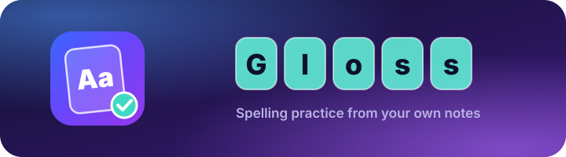
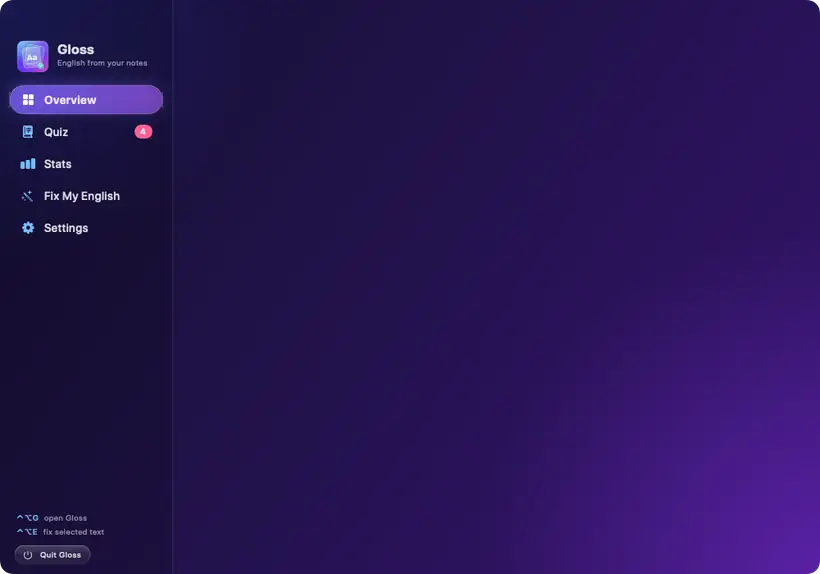
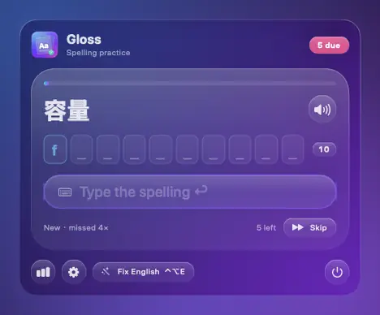
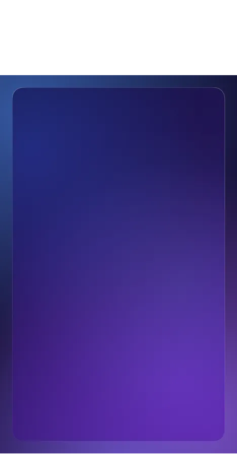
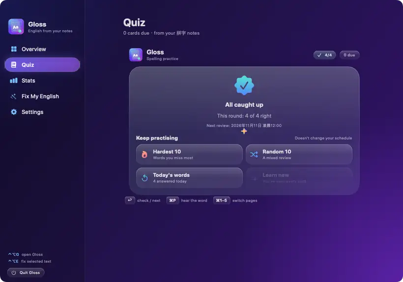
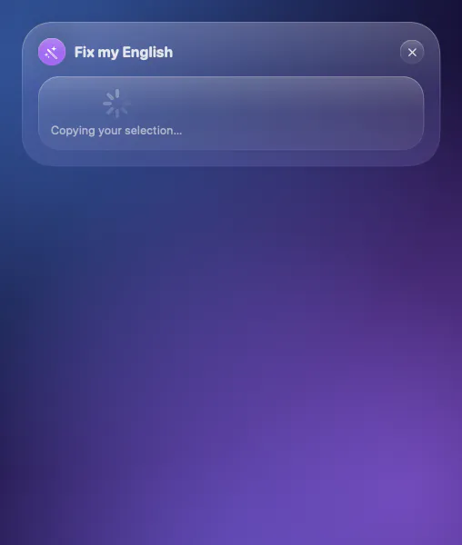

<div align="center">

<picture>
  <source media="(prefers-color-scheme: dark)" srcset="assets/banner-dark.svg" />
  <source media="(prefers-color-scheme: light)" srcset="assets/banner-light.svg" />
  
</picture>

**A macOS menu bar app that turns the English mistakes in your Obsidian notes into a daily spelling quiz.**

Built for Chinese-speaking engineers who can *say* a word but keep *spelling* it wrong.
It reads your own vocabulary table, schedules each word with **Leitner spaced repetition**,
checks answers **without AI**, and fixes any English you select with one shortcut.

[](#-install)
[](Package.swift)
[](#-features)
[](Tests/GlossCoreTests)
[](#-how-it-works)
[](LICENSE)
[](../../releases/latest)
[](https://github.com/ggwhite/gloss/actions/workflows/ci.yml)

[Install](#-install) · [Features](#-features) · [How it works](#-how-it-works) · [Vault format](#-vault-format) · [Shortcuts](#%EF%B8%8F-shortcuts) · [Build](#-build) · [Release](#-release) · [License](#-license)

</div>

---

<div align="center">
  
</div>

## 📦 Install

1. Download **Gloss-vX.Y.Z-macOS-universal.dmg** from the [latest release](../../releases/latest) (Apple silicon and Intel), or build it yourself with `make dmg`.
2. Open it and drag **Gloss** onto **Applications** (or run `make install`).
3. Open Gloss. It lives in the menu bar (the book icon with the number of cards due); press **⌃⌥G** to open its window.
4. In Settings, turn on **Launch at login**, and allow **Accessibility** for Fix My English.

> The first launch shows the overview with a short "Gloss lives in your menu bar" note.
> There is no Dock icon.

## ✨ Features

<table>
<tr>
<td width="42%" valign="middle">

### Spell it, box by box

The card shows the **Chinese meaning**, the first letter and one **box per letter**.
Letters pop into the boxes as you type; **Enter** checks. A right answer bursts into
sparks and the boxes turn mint one by one. A wrong one **shakes the card**, marks the
letters you got wrong, shows your **memory hint** and brings the card back later in
the round. The cursor stays in the answer field, so you never touch the mouse.

</td>
<td></td>
</tr>
<tr>
<td width="42%" valign="middle">

### An overview in the menu bar

Click the book icon for **English Health**, cards due now, **7-day accuracy**, your
**streak**, the **Leitner boxes**, this week's top mistake categories and a
**recommendation** for what to do next. Tiles fade in one after another, numbers roll
up and bars grow.

</td>
<td></td>
</tr>
<tr>
<td width="42%" valign="middle">

### Keep practising after today's cards

When the day's reviews are done, pick **Hardest 10**, **Random 10**, **Today's words**
or **Learn 10 new**. Practice rounds never change your review schedule or your accuracy.

</td>
<td></td>
</tr>
<tr>
<td width="42%" valign="middle">

### Fix My English — ⌃⌥E

Select English in any app and press **⌃⌥E**. Gloss copies the selection (and puts your
clipboard back), asks the local **`claude`** command, and shows a **fixed** version, a
**shorter** one a native speaker would say, and each mistake with a Chinese explanation
and its category. **Listen** reads it aloud; **Copy** puts it on the clipboard.

</td>
<td></td>
</tr>
</table>

**Also in the box**

- 🔊 **Pronunciation** with the macOS English voice (⌘P on a card; spoken after each answer; optional dictation mode).
- 📊 **Stats**: mistakes per category for 7 and 30 days, your 10 most repeated words, quiz accuracy per day.
- 🔔 **Nudges**: a notification every 60 minutes while cards are due, outside quiet hours (22:00–09:00). Click it to open the quiz.
- 🫧 **Dark blue-violet Liquid Glass** on macOS 26 (frosted material on 14–15), with motion that switches off under *Reduce motion*.
- 👀 **Live reload**: the vault is watched with FSEvents and re-read every 60 seconds.

## 🧠 How it works

| | |
|---|---|
| **Where the words come from** | The table under `## 拼字` in your `單字.md` (and `## 用字` if you turn that deck on). Nothing is generated. |
| **How an answer is checked** | **No AI.** Your typing must equal the correct spelling, ignoring case and extra spaces. On a mistake, an edit-distance comparison marks the letters that differ. |
| **When AI is used** | Only by **Fix My English**, which sends the text you select or paste to the `claude` command (Claude Code) on your Mac. |
| **What runs offline** | The quiz, the schedule, stats, reminders and pronunciation. Gloss **never writes to your vault**. |

### Spaced repetition

| Box | Next review | |
|---|---|---|
| 1 | 10 minutes | a wrong answer always goes back here |
| 2 | 1 day | |
| 3 | 3 days | |
| 4 | 7 days | |
| 5 | 21 days | |

A right answer moves a card up one box, and a card you got right is not shown again the same day.
New cards come in order of how often you misspelled them (10 a day, adjustable).
Progress is saved in `~/Library/Application Support/Gloss/state.json`, keyed by the correct spelling.
Every number is listed in [MECHANICS.md](MECHANICS.md).

## 🗂 Vault format

The vault folder defaults to `~/ob/英文` (`~` is expanded and symlinks are followed, so iCloud Drive works).

**`單字.md`** — Markdown tables under level-2 headings:

```markdown
## 拼字（會唸、不會拼）

| 正確拼法 | 你打的 | 中文 | 記法 | 次數 |
|---|---|---|---|---|
| flumbrance | flumberance | 容量 | **flum** + brance | 4 |
```

| Column | Used as |
|---|---|
| 正確拼法 | the answer |
| 你打的 | what you typed (shown in stats) |
| 中文 | the question |
| 記法 | the hint after a mistake |
| 次數 | how often you missed it (1 when missing) |

Cells may use `**bold**`, backticks and `?`; Gloss strips the Markdown, and rows with missing columns still load.

**`錯誤紀錄/YYYY-MM-DD.md`** — one mistake per line, for the stats:

```markdown
- `original` → `fix` — 中文說明 #類別
```

Categories: `#冠詞 #動詞形式 #單複數 #拼字 #用字 #介系詞 #句型`.

## ⌨️ Shortcuts

| Keys | Does |
|---|---|
| **⌃⌥G** | open or hide the Gloss window (configurable) |
| **⌃⌥E** | fix the selected English (configurable) |
| **Enter** | check the answer / next card |
| **⌘P** | hear the word |
| **⌘1 – ⌘5** | Overview, Quiz, Stats, Fix My English, Settings |
| **⌘[** | back to the overview in the menu |

## 🔐 Permissions

- **Accessibility** — Fix My English sends ⌘C to the front app. Gloss shows a button that opens *System Settings → Privacy & Security → Accessibility*.
- **Notifications** — for the nudges; asked on first launch.
- **Claude Code** — Fix My English runs `claude`, found with `/bin/zsh -lc 'command -v claude'`. Missing or slower than 30 seconds, the panel says so.

## 🛠 Build

Needs macOS 14+ and Xcode 15+ (Swift 5.9).

```sh
swift build        # debug build
swift test         # GlossCore unit tests
make app           # build/Gloss.app
make install       # build, sign and copy to /Applications
make dmg           # build/Gloss.dmg
make demos         # re-record the animated pictures in assets/ (needs ffmpeg and webp)
make icon          # redraw Resources/AppIcon.icns from Sources/Gloss/IconArt.swift
```

Developer options:

```sh
.build/debug/Gloss --screenshot shots/now.png            # draws a demo window off-screen, saves a PNG
.build/debug/Gloss --screenshot shots/p.png --page stats # one page of the main window
.build/debug/Gloss --self-test shots/self-test.json      # drives a demo quiz and checks each step
.build/debug/Gloss --record /tmp/rec --scene quiz        # frames for the README animations
```

All of them use a built-in deck of **made-up words** and never touch your vault or saved progress.

| Folder | What |
|---|---|
| `Sources/GlossCore` | parsing, Leitner scheduling, answer checking, stats, practice — no UI, unit-tested |
| `Sources/Gloss` | the SwiftUI app: menu bar, window, quiz, glass, motion, hotkeys, `claude` runner |
| `Tests/GlossCoreTests` | XCTest suites with made-up fixtures |
| `assets/` | README banner and animations |

## 🚀 Release

Push a version tag and GitHub Actions does the rest, like this:

```sh
git tag v0.1.0 && git push origin v0.1.0
```

The [release workflow](.github/workflows/release.yml) runs the tests on a macOS 26 runner, builds a
**universal** app (arm64 + x86_64), signs it with your **Developer ID**, **notarizes** and staples the DMG,
and attaches `Gloss-v0.1.0-macOS-universal.dmg` and `checksums.txt` to the release.
It needs these repository secrets (*Settings → Secrets and variables → Actions*):

| Secret | Value |
|---|---|
| `MACOS_CERTIFICATE_P12` | base64 of your exported *Developer ID Application* certificate (`base64 -i cert.p12`) |
| `MACOS_CERTIFICATE_PASSWORD` | the password you gave the .p12 |
| `MACOS_CODESIGN_IDENTITY` | `Developer ID Application: Your Name (TEAMID)` |
| `NOTARY_KEY_P8` | base64 of an App Store Connect API key (`base64 -i AuthKey_XXXX.p8`) |
| `NOTARY_KEY_ID` | that key's ID |
| `NOTARY_ISSUER_ID` | your issuer ID |

Instead of the API key you can notarize with an Apple ID: `NOTARY_APPLE_ID`, `NOTARY_PASSWORD`
(an app-specific password) and `NOTARY_TEAM_ID`.

`scripts/setup-release-secrets.sh` sets them from your Mac without printing anything secret:

```sh
scripts/setup-release-secrets.sh cert                     # exports your Developer ID identity (macOS asks to allow)
scripts/setup-release-secrets.sh notary-apple-id          # or: notary-key ~/Downloads/AuthKey_XXXX.p8 <issuer-id>
gh workflow run release.yml -f tag=v0.1.0                 # rebuild the release, signed and notarized
```

Without them the workflow still publishes the DMG, ad-hoc signed and marked *not notarized*.
To rebuild an existing tag after adding secrets: *Actions → Release → Run workflow*.

Locally, `make dmg` and `make install` sign with the first Developer ID certificate in your keychain
(the first time, macOS asks to let `codesign` use the key: choose **Always Allow**), and notarize when
`NOTARY_KEY_PATH`/`NOTARY_KEY_ID`/`NOTARY_ISSUER_ID` or `NOTARY_PROFILE` is set.

## 📄 License

[MIT](LICENSE)
